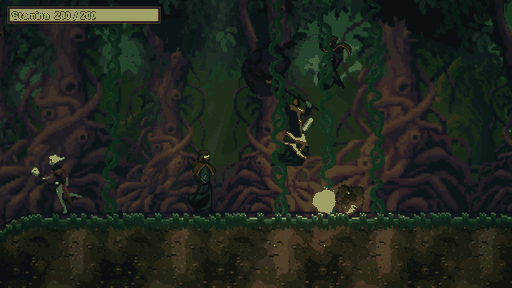
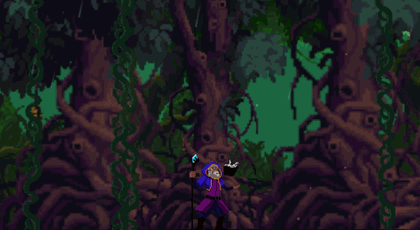
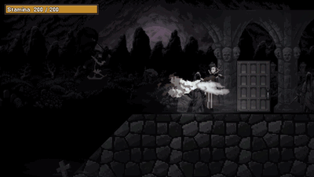
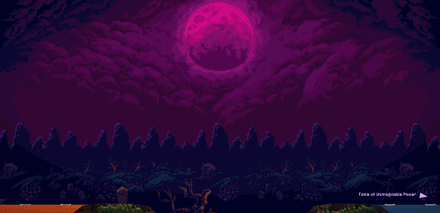
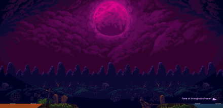
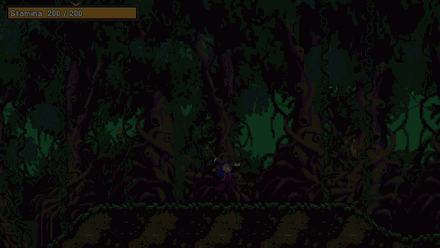

# Wizard Game

You are one of eight wizards dropped into a world, each with an empty spellbook. Learn spells by picking up the pages scattered around the map. The last wizard standing wins.



## You cast by drawing

Hold down a mouse button and draw the spell's shape on the screen.

- Each spell has its own shape. Fire breath is a `<`, a geyser is an arrow pointing up, and a black hole is a spiral.


- Some spells are chants: press Enter and type them.



The other wizards draw their spells the same way, in plain view.



Spells have no sides: they hurt whoever they touch, the wizard who cast them included.

Freeze a pond to cross it. Fire melts the ice again.



A Barrier blows a fireball away.



## A match

A match has eight wizards: you, and seven others who are AI or friends over a network. You play through four worlds, chosen from these:

- graveyard
- jungle
- snowy mountains
- volcanoes
- castles
- underground caves
- portals
- ocean
- sky



## Also in the game

- **Waiting room.** Where you start. Try any spell here.
- **Tutorial.** A row of obstacles that teaches you the game.
- **Library.** Keeps track of your matches on this machine.
- **Network play.** Play with friends on a local network or by typing in an address. One player hosts, and AI wizards fill any empty seats. You can also run a dedicated server.

## Playing

Download the latest `.exe` from [Releases](https://github.com/jpolun814/wizard-game/releases/latest) and run it. Windows may say it protected your PC: click More info, then Run anyway.

## Controls

| Key | What it does |
|---|---|
| A / D | Walk |
| W or Space | Jump |
| S | Drop through a wooden platform |
| Mouse buttons | Left casts fire, right casts water, middle casts air. Hold two or three together for the other schools |
| Tab | Open the spellbook (arrow keys turn pages) |
| Enter | Type a chant |
| Esc | Pause and see the controls |
| M | Mute |

## Art and sound

The pictures and sounds come from free packs by other people. Every source and licence is listed in [`art/CREDITS.md`](art/CREDITS.md).

---

## For developers

The game is written in GDScript for **Godot 4.7.2**, and the engine is all you need.

```
godot --path .                       # run the game (the main scene is the menu)
godot --headless --path . --import   # after adding or moving assets, or adding a class_name
```

### Tests

```
python tools/run_checks.py           # the quick set, about two minutes
python tools/run_checks.py --full    # everything, about six minutes
python tools/run_checks.py name ...  # only the checks with these names
```

Checks live in `tests/checks/` (they pass or fail), `tests/looks/` (they take screenshots for a person to look at, and need a window) and `tests/tools/` (simulations and measurements). `docs/handoff/07_testing.md` says what each one proves.

`tests/checks/tutorial_ai_check.tscn` lets an AI wizard walk the whole tutorial. It is too long for either set, and it is known to stop at the first pond of piranhas (see `docs/handoff/16_open_work.md`).

### Running a server

```
godot --headless --path . -- --server
```

This opens a host with nobody at it, on UDP port 24565 (set `WIZARD_PORT` to change it). Players join with the Join box on the menu. `tools/run_server.bat` also asks the router to forward the port.

### Where things are

| Folder | What is in it |
|---|---|
| `scripts/` | The game, sorted by what it is: `core`, `wizard`, `brain` (the AI), `arena` (a match), `spells`, `creatures`, `terrain`, `world`, `scenery`, `screens`, `ui`, `gesture`, `fx` |
| `data/spells/` | One `Spell` resource per spell. These are the source of truth for names, costs and gestures |
| `scenes/` | The game's scenes |
| `art/`, `audio/` | Pictures and sounds, with their sources in `art/CREDITS.md` |
| `tools/` | Python scripts that cut and recolor the art, and the check runner |
| `docs/` | Design notes, and `docs/handoff/` with one chapter per area of the code |

The CraftPix characters are free to use in a game but may not be resold or passed on as files, so keep that in mind before making the repository public or reusing the art.

To read about a part of the code before changing it, start with `CLAUDE.md` (the rules the project keeps and why) and then the chapter in `docs/handoff/` for that area. `02_codebase_map.md` has every script.

Some rules worth knowing before you add anything:

- Every spell is its own script, and the spell's resource names it. Don't add a branch on a spell's name to a shared script.
- Anything a player reads follows the wording rules at the top of `CLAUDE.md`.
- The gesture code in `scripts/gesture/` knows nothing about spells, so it can run under `-s` where the autoloads are missing.

### Making a GIF

Both ways need a window and a fixed frame rate, and `tools/make_gif.py` puts the saved pictures together.

A match, played by the AI:

```
godot --fixed-fps 60 --path . tests/tools/arena_sim.tscn -- seed=3 seconds=45 duel=1 plain=1 zoom=2.2 "a=Ignite,Fire Breath" "b=Frostbolt,Barrier" frames=OUT_DIR every=5
```

`duel=1` puts two wizards face to face with the spells named in `a=` and `b=`, and the rest of the match is put away. `plain=1` leaves off the color grade, which tints the picture. Different `seed` values give different first worlds.

A scripted feature, with the wizard drawing the strokes on screen (`WORLD_SEED` picks the place):

```
WORLD_SEED=0 godot --fixed-fps 60 --path . tests/looks/showcase.tscn -- scenario=reel reel=draw film=1 every=3 out=OUT_DIR
```

Then:

```
python tools/make_gif.py OUT_DIR clip.gif --fps 14 --width 440 --crop 120,150,1160,720
```

All the pictures share one palette and nothing is dithered, so the pixel art stays clean. `--crop` keeps the part of each picture that shows the action, which makes the file smaller.
