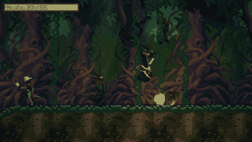
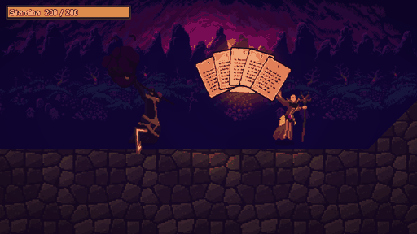
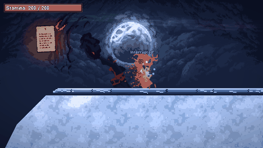

# Wizard Game

You are one of eight wizards dropped into the same world, and everyone starts with an empty spellbook. The pages are lying around: on ledges, in crypts, at the top of great trees, at the bottom of ponds. Read one and you learn a spell. Then you go and use it on the other seven, because the last wizard standing wins.

It is a 2D side-view duel made in Godot, in dark pixel art.



## You cast by drawing

There is no spell bar. To cast, you hold down a mouse button and draw the spell's shape on the screen.

- Each school of magic has its own button, or its own pair of buttons. Left is fire, right is water, middle is air, and the combinations are earth, plants, shadow and blood.
- The shape is a picture of what you want. A fire cone is drawn as a `<`. A geyser is an arrow pointing up. A black hole is a spiral winding in. Stonefall is a circle with a line dropping out of it, and the boulder falls from the circle.
- The dearer a spell is, the more involved its shape. A quick flick throws a fireball; a star about to die takes two loops drawn in one go.
- A few spells are rituals instead. Press Enter and type a chant in pseudo-Latin. The cleaner your typing, the stronger the result, and a sloppy chant can go wrong.



The other seven wizards cast the same spells the same way. When one of them throws a fireball, you can watch the stroke being drawn a moment before.

Spells have no sides. Fire burns whoever is standing in it, including the wizard who lit it. A boulder from Stonefall lands on whoever is under it. Almost everything can be stopped, dodged or hidden from, but you have to work out how by playing.

## A match

A match is you and seven rivals (friends over a network, with AI wizards in any empty seat). You pass through four worlds, picked from nine places:

- a blood-moon graveyard
- a jungle with rope bridges between giant trees
- snowy peaks, with avalanches and sheets of ice
- ashlands, where volcanoes erupt
- a row of castles, six floors deep
- an underground cavern
- the portal fields, where portals open every few seconds and carry you somewhere else
- a drowned sea, mostly under water
- an open sky with nothing to stand on

Pages are dealt out when the match starts, so no two wizards begin with the same ones and no page is lying in the world once someone has read it. Some places are locked until you have a spell that opens them.



## Other things in the box

- **Waiting room.** Where you start. Every spell is known here, so you can try anything before you touch the book that starts a game.
- **Tutorial.** A long row of obstacles with the pages that beat them lying at their feet. There are no pop-ups. You learn it by getting stuck.
- **Library.** Remembers how your matches went on this machine: how often you found each page, cast each spell, and won with it in your book.
- **Network play.** Play on a local network or by typing in an address. One player hosts, the AI fills the empty seats. A dedicated server is possible too.

## Controls

| Key | What it does |
|---|---|
| A / D | Walk |
| W or Space | Jump |
| S | Drop through a wooden platform |
| Left, Right, Middle mouse | Draw with fire, water, air (hold two or three together for the other schools) |
| Tab | Open the spellbook (arrow keys turn pages) |
| Enter | Type a chant |
| Esc | Pause and see the controls |
| M | Mute |

## Art and sound

The pictures and sounds come from free packs by other people, and nothing here is drawn by the game's code except the interface. Every source and licence is listed in [`art/CREDITS.md`](art/CREDITS.md). The CraftPix characters are free to use in a game but may not be resold or passed on as files, so keep that in mind before making the repository public or reusing the art.

---

## For developers

The game is written in GDScript for **Godot 4.7.2**. There is nothing to install beyond the engine.

```
godot --path .                       # run the game (the main scene is the menu)
godot --headless --path . --import   # after adding or moving assets, or adding a class_name
```

### Tests

```
python tools/run_checks.py           # the quick set, about two minutes
python tools/run_checks.py --full    # everything, about six minutes
python tools/run_checks.py name ...  # only the checks with these names
```

Checks live in `tests/checks/` (they pass or fail), `tests/looks/` (they take screenshots for a person to look at, and need a window) and `tests/tools/` (simulations and measurements). `docs/handoff/07_testing.md` says what each one proves.

A few checks fail on a clean copy and are known about: `tutorial_ai_check`, `test_world` and, now and then, `page_count_check`. `limits_check`, `interaction_check` and `pull_check` are occasionally flaky. They are listed in `docs/handoff/16_open_work.md`.

### Running a server

```
godot --headless --path . -- --server
```

This opens a host with nobody at it, on UDP port 24565 (set `WIZARD_PORT` to change it). Players join with the Join box on the menu. `tools/run_server.bat` also asks the router to forward the port.

### Where things are

| Folder | What is in it |
|---|---|
| `scripts/` | The game, sorted by what it is: `core`, `wizard`, `brain` (the AI), `arena` (a match), `spells`, `creatures`, `terrain`, `world`, `scenery`, `screens`, `ui`, `gesture`, `fx` |
| `data/spells/` | One `Spell` resource per spell. These are the source of truth for names, costs and gestures |
| `scenes/` | The few scenes there are |
| `art/`, `audio/` | Pictures and sounds, with their sources in `art/CREDITS.md` |
| `tools/` | Python scripts that cut and recolor the art, and the check runner |
| `docs/` | Design notes, and `docs/handoff/` with one chapter per area of the code |

To read about a part of the code before changing it, start with `CLAUDE.md` (the rules the project keeps and why) and then the chapter in `docs/handoff/` for that area. `02_codebase_map.md` has every script.

Some rules worth knowing before you add anything:

- Every spell is its own script, and the spell's resource names it. Don't add a branch on a spell's name to a shared script.
- Anything a player reads follows the wording rules at the top of `CLAUDE.md`.
- The gesture code in `scripts/gesture/` knows nothing about spells, so it can run under `-s` where the autoloads are missing.

### Making a GIF of a match

The simulation can record itself. It needs a window and a fixed frame rate:

```
godot --fixed-fps 60 --path . tests/tools/arena_sim.tscn -- seed=3 seconds=45 duel=1 zoom=2.2 "a=Ignite,Fire Breath" "b=Frostbolt,Barrier" frames=OUT_DIR every=5
```

`duel=1` puts two wizards face to face with the spells named in `a=` and `b=`, and the rest of the match is put away. A small picture is saved every five frames, and Pillow can put them together into a GIF. Different `seed` values give different first worlds. Give each frame its own palette when you do, or the pale colors go wrong.
